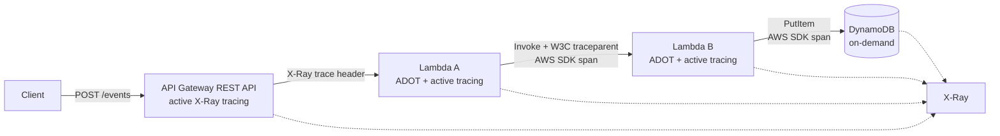

# AWS X-Ray distributed tracing demo

Small, low-cost serverless proof of concept for end-to-end tracing:

`Client -> API Gateway REST API -> Lambda A -> Lambda B -> DynamoDB`

The repository is intentionally small. It uses Terraform, Python Lambda functions, the AWS-managed AWS Distro for OpenTelemetry (ADOT) Python layer, and AWS X-Ray. It does not deploy anything automatically.

## Architecture



API Gateway and Lambda active tracing provide the AWS-managed request segments. ADOT auto-instruments the Lambda handlers and AWS SDK calls. Lambda A also injects the current OpenTelemetry context into the Lambda B event; Lambda B extracts it before creating its application span. The DynamoDB call runs under that active context and is instrumented by the ADOT AWS SDK instrumentation.

## Repository layout

- `terraform/` - provider, IAM, API Gateway, Lambda, DynamoDB, tracing, and log-group resources.
- `lambda/lambda_a/` - request validation, correlation ID handling, and Lambda B invocation.
- `lambda/lambda_b/` - controlled failure handling and DynamoDB write.
- `tests/` - local unit tests using fake AWS clients; no AWS account is required.
- `scripts/` - deployment, test-request, and cleanup helpers.
- `docs/architecture.md` - standalone architecture diagram.
- `docs/tracing-validation.md` - validation procedure and deployment evidence checklist.
- `docs/cost-estimate.md` - cost assumptions and cleanup guidance.

## AWS services used

- API Gateway REST API
- Two AWS Lambda functions (Python 3.12, 128 MB, short timeout)
- DynamoDB in on-demand mode
- AWS X-Ray
- CloudWatch Logs with 7-day retention
- AWS-managed ADOT Python Lambda layer (regional ARN supplied as a Terraform variable)

No VPC, NAT Gateway, EC2, load balancer, provisioned concurrency, API Gateway usage plan, dashboard, alarm, or DynamoDB backup is created.

## Trace attributes and correlation

Both functions create application spans with these low-cardinality attributes:

- `correlation_id` - caller-provided or generated ID, restricted to 64 characters.
- `operation` - for example `api_request`, `invoke_lambda_b`, or `write_record`.
- `function_name` - logical function name.
- `request_type` - `api` or `lambda`.

The message is never added to a trace attribute. It is stored in DynamoDB only as the small demo payload requires. The helper also sets the X-Ray `aws.xray.annotations` reserved attribute so these four fields are indexed annotations rather than ordinary metadata; use the trace details page to confirm the annotations exposed by the deployed layer version.

## Prerequisites

- Terraform 1.5+.
- AWS CLI configured with credentials for the target account and region.
- Python 3.10+ for local tests.
- `curl` for the request scripts.

The deployment role needs permission to create the resources in `terraform/` and to pass the two Lambda execution roles. Credentials are read by the AWS provider/CLI; none are stored in this repository.

## Deploy

Choose a region where the ADOT layer is published. The default is `us-east-1`; override the layer ARN when using another region. The current regional ARNs are published in the [ADOT Lambda documentation](https://aws-otel.github.io/docs/getting-started/lambda/).

```bash
terraform -chdir=terraform init
terraform -chdir=terraform plan \
  -var='region=us-east-1' \
  -var='project_name=xray-demo' \
  -var='environment=dev'

./scripts/deploy.sh
```

For a non-default region, pass the matching current ADOT Python layer ARN:

```bash
./scripts/deploy.sh eu-west-1 \
  arn:aws:lambda:eu-west-1:615299751070:layer:AWSOpenTelemetryDistroPython:29
```

The script runs `terraform apply` after `terraform init`. It does not run unless you invoke it.

## Test a deployed API

Successful request:

```bash
./scripts/test-success.sh
```

Equivalent request:

```bash
curl -sS -X POST "$(terraform -chdir=terraform output -raw api_endpoint)" \
  -H 'content-type: application/json' \
  -d '{"message":"hello","correlation_id":"demo-123"}'
```

Controlled failure (Lambda B raises before the DynamoDB write; Lambda A returns HTTP 502):

```bash
./scripts/test-error.sh
```

The response includes a correlation ID. The functions log the same ID, but do not log or trace secret data.

## Inspect traces and service map

For a new deployment, send at least one successful and one error request. Allow a short delay for X-Ray ingestion, then:

1. Open the AWS X-Ray console in the deployment region and choose **Traces**.
2. Search for the deployed API/function names or use a recent time range.
3. Open a successful trace and confirm the API Gateway segment, Lambda A segment, Lambda B segment, DynamoDB downstream call, and the application span attributes.
4. Open the error trace and confirm the Lambda B exception/error status and the Lambda A dependency error.
5. Open **Service map** and select the matching time range. Confirm the API Gateway, Lambda, and DynamoDB nodes/edges.

The AWS deployment for this assessment was validated in `us-east-1` on 2026-11-05. The completed evidence report is [`docs/tracing-validation.md`](docs/tracing-validation.md). It records the successful trace `1-6aec05b6-724d0df5470e145c567f3665`, the error trace `1-6aec064b-596f141d2d2693a228231202`, the successful DynamoDB write, the controlled error, and the X-Ray Service Map. The report also identifies which annotation and context-carrier details are source-verified but not directly visible in the supplied screenshots.

For CLI-oriented investigation, useful commands include:

```bash
aws xray get-service-graph --start-time "$(date -u -d '15 minutes ago' +%s)" --end-time "$(date -u +%s)"
aws xray get-trace-summaries --start-time "$(date -u -d '15 minutes ago' +%s)" --end-time "$(date -u +%s)" --sampling
```

The console is preferred for screenshots because it shows the trace tree and service map together. Correlation IDs are also corroborated in the Lambda and CloudWatch log evidence. The supplied screenshots do not include a raw annotation-details panel, so the report does not claim that indexed annotation rendering was visually confirmed.

## Local validation

These tests do not contact AWS and do not prove X-Ray or service-map behavior:

```bash
python3 -m unittest discover -s tests -v
python3 -m py_compile lambda/lambda_a/*.py lambda/lambda_b/*.py tests/*.py
terraform -chdir=terraform fmt -check -recursive
terraform -chdir=terraform validate
git diff --check
```

`terraform validate` requires the provider plugins to have been initialized. A plan requires AWS credentials and network access, but is still non-mutating.

## Cost and cleanup

This demo has no guaranteed zero-cost price. Free Tier eligibility depends on account age, region, usage, and current AWS terms. Relevant current pricing pages and assumptions are recorded in [`docs/cost-estimate.md`](docs/cost-estimate.md).

Destroy everything created by Terraform when finished:

```bash
./scripts/destroy.sh
```

The cleanup script deletes the exact demo DynamoDB table from Terraform output before running `terraform destroy`, so test records cannot prevent table deletion. Review the destroy plan and script output before applying cleanup. Also check X-Ray and CloudWatch consoles after cleanup for retained telemetry or logs from the short retention window.

## EPAM Development Justification artifacts

Attach or link:

1. The GitHub repository URL for this project.
2. [`docs/architecture.md`](docs/architecture.md) or an exported screenshot/PDF of its diagram.
3. [`docs/tracing-validation.md`](docs/tracing-validation.md), completed with the real deployment date, region, trace IDs, and evidence links.
4. A successful X-Ray trace screenshot showing the API Gateway -> Lambda A -> Lambda B -> DynamoDB path and correlation annotation/attribute.
5. A service-map screenshot showing the deployed components.
6. An error-trace screenshot for the controlled failure.

Items 1-3 are maintained in this repository. The ten screenshots used by the completed report remain in the supplied local directory `/mnt/c/Users/SergeyYakovenko/Downloads/x-ray/`; attach them with the report when submitting the EPAM evidence package. The screenshots are not copied into the repository or renamed.

## Current implementation note

AWS documentation currently recommends ADOT for new Lambda instrumentation and lists AWS X-Ray SDK support ending on February 25, 2027. This project therefore uses ADOT rather than adding the legacy X-Ray SDK to the function packages. The ADOT layer ARN is intentionally configurable because it is region- and release-specific.
