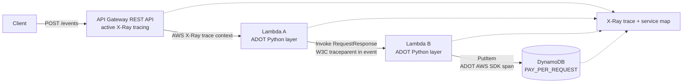

# Architecture diagram

Tracing is enabled on API Gateway and both Lambda functions. The ADOT layer exports Lambda and AWS SDK telemetry to X-Ray. Lambda A explicitly injects the active W3C context into the Lambda B event, and Lambda B extracts it before starting its application span.
