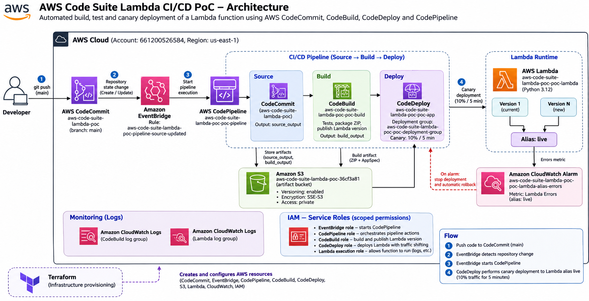

# AWS Code Suite Lambda CI/CD PoC

An isolated Proof of Concept demonstrating a complete CI/CD flow on AWS:

```text
CodeCommit -> CodePipeline -> CodeBuild -> CodeDeploy -> Lambda alias
```



The PoC does not use resources from the main X-Ray demo and does not modify
files outside `poc/aws-code-suite/`.

## Resources created

- A dedicated CodeCommit repository.
- A CodeBuild project using a Linux managed image with Python 3.12.
- An S3 artifact bucket with versioning, encryption and Block Public Access.
- A dedicated Python 3.12 Lambda function, Lambda alias `live` and execution role.
- A CodeDeploy Lambda application and deployment group using
  `CodeDeployDefault.LambdaCanary10Percent5Minutes`.
- A CodePipeline with Source, Build and Deploy stages.
- An EventBridge rule that starts the pipeline after updates to the `main` branch.
- A CloudWatch alarm for Lambda errors, used by CodeDeploy to stop the canary
  deployment.

## Important Lambda deployment detail

CodeDeploy does not upload the ZIP file to the Lambda function. The ZIP must
first become a new published Lambda version, after which CodeDeploy shifts the
alias between `CurrentVersion` and `TargetVersion`.

Therefore, `build/buildspec.yml` performs two related actions:

1. It runs unit tests and creates `lambda.zip`.
2. It uses the AWS CLI to update the dedicated PoC Lambda with `--publish`,
   obtains the new version number and dynamically generates `appspec.yml`.

The build artifact contains both the ZIP for auditing and the actual AppSpec
revision used by CodeDeploy. Terraform creates only the bootstrap function
version and alias.

## Bootstrap

Requirements: Terraform >= 1.5, AWS credentials with permission to create the
described resources, and configured Git authentication for CodeCommit.

### 1. Create the infrastructure

```bash
cd poc/aws-code-suite/terraform
terraform init
terraform apply
```

The pipeline is created during this step, but it does not start because the
source repository does not yet contain a `main` branch and the source action is
configured without polling. This allows the complete resource set to be created
with one Terraform apply without a dummy source artifact.

Get the repository URL:

```bash
terraform output -raw codecommit_clone_url_http
```

### 2. Create the initial commit

Copy the PoC source into a fresh clone of the CodeCommit repository. For example:

```bash
POC_DIR="/absolute/path/to/poc/aws-code-suite"
cd /tmp
git clone "$(cd "$POC_DIR/terraform" && terraform output -raw codecommit_clone_url_http)" aws-code-suite-lambda-poc
cd aws-code-suite-lambda-poc
cp -R "$POC_DIR/application" .
cp -R "$POC_DIR/build" .
cp -R "$POC_DIR/deploy" .
git add application build deploy
git commit -m "Initial Lambda CI/CD application"
git push origin HEAD:main
```

In the working copy, `POC_DIR` must point to the `poc/aws-code-suite`
directory, not to the Terraform subdirectory.

The push creates a CodeCommit event. EventBridge starts the pipeline
automatically.

### 3. Check the pipeline

```bash
cd poc/aws-code-suite/terraform
aws codepipeline get-pipeline-state \
  --name "$(terraform output -raw codepipeline_name)" \
  --query 'stageStates[].{stage:stageName,status:latestExecution.status}'
```

After a successful Deploy stage, invoke the alias and verify the response:

```bash
aws lambda invoke \
  --function-name "$(terraform output -raw lambda_function_name):$(terraform output -raw lambda_alias_name)" \
  --payload '{}' /tmp/aws-code-suite-response.json
cat /tmp/aws-code-suite-response.json
```

The response contains `statusCode: 200`, a message and a shortened version of
the source commit SHA. With every subsequent commit, the Build stage generates
a new Lambda version and the Deploy stage performs a canary alias shift.

## Rollback verification

The deployment group uses automatic rollback for `DEPLOYMENT_FAILURE` and
`DEPLOYMENT_STOP_ON_ALARM`, together with a CloudWatch alarm for Lambda errors.
To test it, temporarily push code that fails when the Lambda is invoked and
invoke the alias during the canary window. The alarm should move the deployment
to a failed state, after which CodeDeploy returns the alias to the previous
version.

## Deletion

By default, the artifact bucket has `force_destroy = true`, so Terraform also
deletes its versioned objects:

```bash
cd poc/aws-code-suite/terraform
terraform destroy
```

You can override this behavior with
`-var='artifact_bucket_force_destroy=false'` if the bucket must survive
`terraform destroy`. In that case, delete its objects and delete markers
manually first.

## IAM and integration points

- CodeCommit stores the source and acts as the pipeline Source provider.
- CodePipeline retrieves the commit, passes the source artifact to CodeBuild,
  and passes the build artifact to CodeDeploy.
- CodeBuild can read and write the pipeline artifact bucket, publish a version
  of only this PoC Lambda, and write its CloudWatch Logs.
- CodeDeploy can manage the Lambda alias/version transition, read the revision
  from the artifact bucket, and read the deployment alarm.
- The Lambda execution role contains only permissions for the function's own
  CloudWatch Logs.
- The EventBridge role can start only this pipeline.

Broad managed policies such as `AdministratorAccess` and `PowerUserAccess` are
not used. The wildcard in the S3 deny policy is a resource-based protection
against insecure transport, not a permission grant. The wildcard in the
CodeDeploy deployment ARN is required to poll dynamically created deployment
IDs and is limited to the current account and region.
